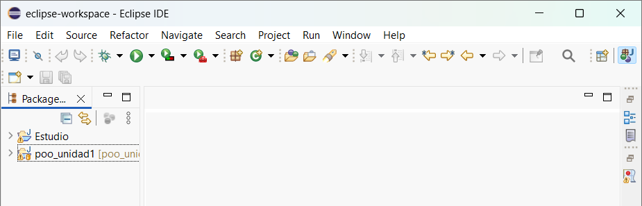
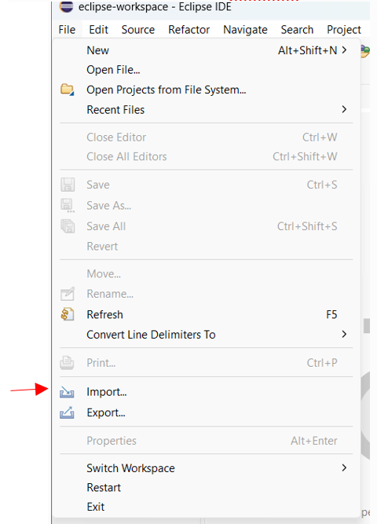
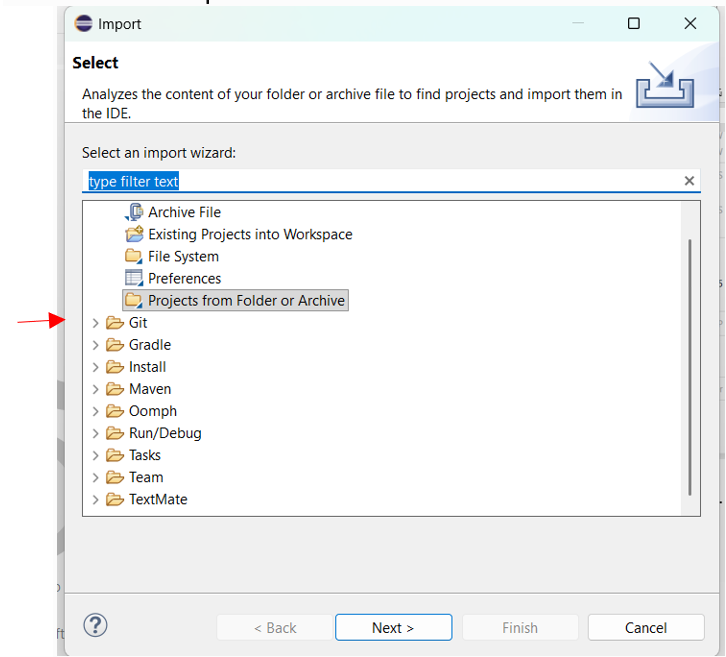
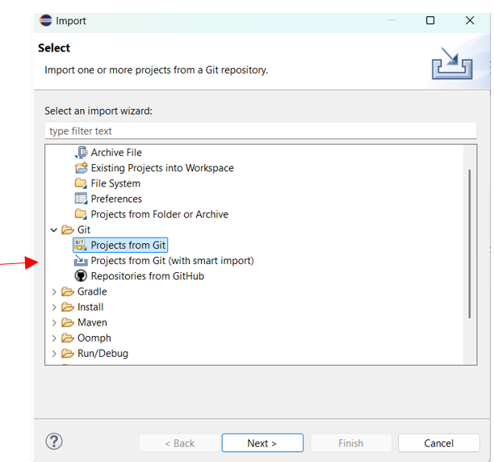
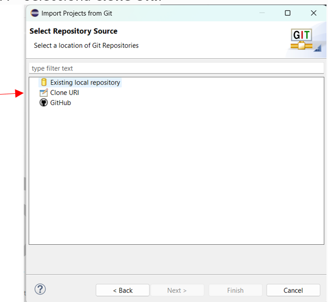
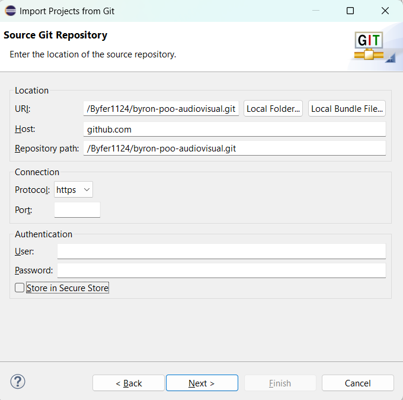

# Sistema de Gestión y Sorteo de Torneo de Fútbol (MVC)

---

**Link del proyecto en GitHub**

URL: `https://github.com/Byfer1124/SorteoDeEquipos.git`

---

📌 **Descripción del proyecto**

Aplicación desarrollada en **Java** bajo el patrón arquitectónico **Modelo-Vista-Controlador (MVC)**, diseñada para gestionar un torneo de eliminación directa de 16 equipos (potencias de 2: 16, 8, 4, 2). El sistema automatiza los emparejamientos mediante algoritmos recursivos, valida restricciones de negocio con excepciones personalizadas y garantiza la persistencia transaccional de los datos mediante serialización binaria.

---

## 🚀 Características Principales

* **Arquitectura MVC:** Separación estricta de responsabilidades entre la lógica del negocio (`modelo`), la gestión de flujos (`controlador`) y la interfaz de usuario por consola (`vista`).
* **Algoritmo Recursivo de Sorteo:** Emparejamiento dinámico y aleatorio que avanza de forma consecutiva por las fases de **Octavos de Final, Cuartos de Final, Semifinales y Gran Final**.
* **Persistencia de Datos:** Capacidad de guardar y cargar el estado completo del torneo (incluyendo equipos e historial de partidos) en un archivo binario (`torneo.ser`) mediante la interfaz `Serializable`.
* **Excepciones Personalizadas:** Control robusto de errores mediante clases como `NumeroEquiposInvalidoException` y `SorteoInvalidoException`.

---

## 🛠️ Tecnologías y Componentes
* **Lenguaje:** Java (POO)
* **Patrón de Diseño:** MVC (Model-View-Controller)
* **Persistencia:** Java I/O (`Serializable`, `ObjectOutputStream`, `ObjectInputStream`)
* **Control de Errores:** Excepciones verificadas (`checked exceptions`)
---

🚀 **Instrucciones para clonar el proyecto desde Eclipse:**

1. Abre Eclipse IDE.



2. Selecciona **File → Import**.



3. Busca la carpeta **Git**.



4. Selecciona **Projects from Git** y presiona **Next**.



5. Selecciona **Clone URI** y presiona **Next**. Pega la siguiente URL: `https://github.com/Byfer1124/SorteoDeEquipos.git`



6. Presiona **Next** y selecciona la rama principal (`main`). Selecciona la ubicación donde deseas guardar el proyecto y presiona **Finish** para completar la clonación.



---

⚙️ **Ejecutar la aplicación**

1. En el explorador de proyectos de Eclipse, localiza la clase principal que contiene el método `main`.
2. Haz clic derecho sobre el archivo.
3. Selecciona **Run As → Java Application**.
4. La aplicación se ejecutará en la consola de Eclipse.

---

📁 **Estructura del proyecto**

El repositorio está organizado de la siguiente manera:

```text

SorteoDeEquipos/
├── src/
│   ├── controlador/    # ControladorTorneo.java (Lógica de control y flujos)
│   ├── modelo/         # Entidades (Torneo, Equipo, Partido) y Excepciones
│   └── vista/          # Main.java y gestión de consola
├── img/                # Carpeta de imágenes y recursos
├── diagrama.uxf        # Diagrama UML (UMLet)
└── torneo.ser          # Archivo binario de persistencia (Serialización)

📐 Diagrama UML

El proyecto incluye el archivo new_diagram.uxf, que contiene el diagrama UML de clases elaborado con UMLet.

Este diagrama representa la estructura del sistema, incluyendo la herencia y las relaciones de asociación, agregación y composición entre las clases.

